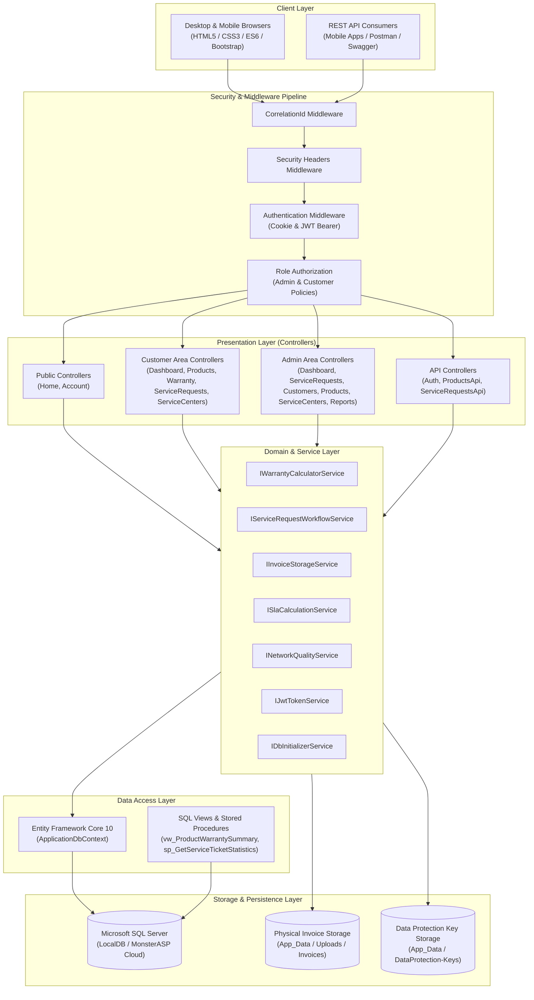
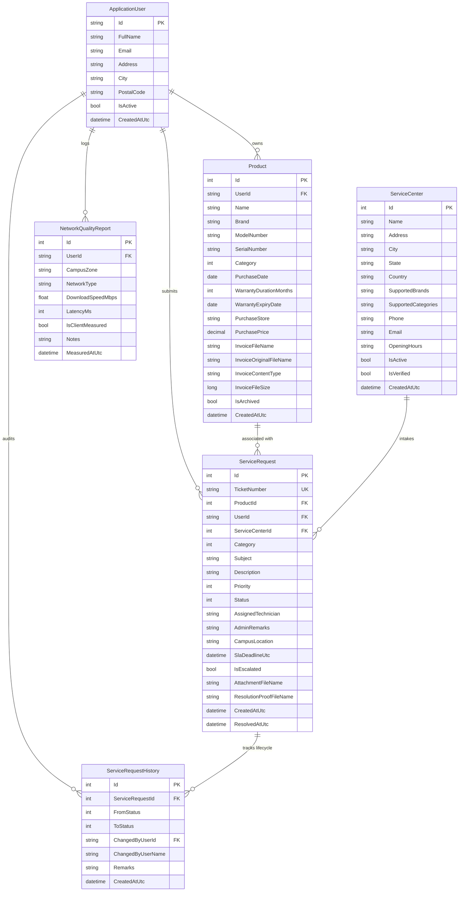
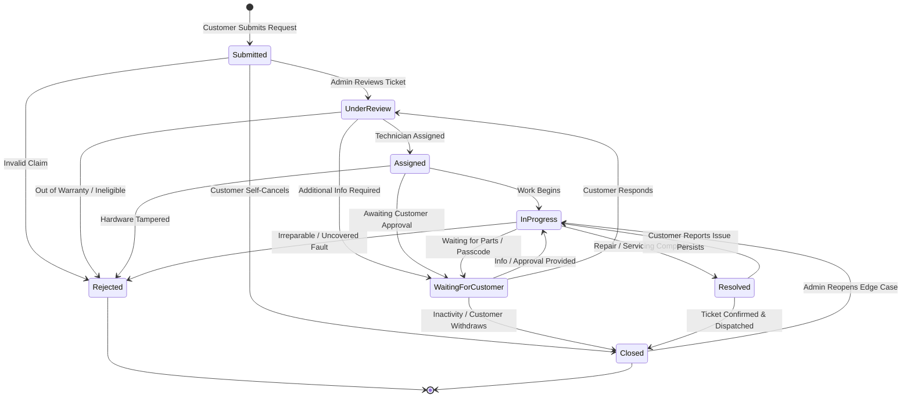

# ProductCare — Product Warranty and Service Management Portal

[](https://dotnet.microsoft.com/)
[](https://learn.microsoft.com/en-us/dotnet/csharp/)
[](https://learn.microsoft.com/en-us/aspnet/core/)
[](https://learn.microsoft.com/en-us/ef/core/)
[](https://www.microsoft.com/sql-server)
[](https://getbootstrap.com/)
[](https://swagger.io/)
[](https://productcare.runasp.net/)

> **ProductCare** is an enterprise-grade, full-stack product warranty tracking, after-sales service orchestration, and diagnostic support portal built with **ASP.NET Core MVC (.NET 10)**, **Entity Framework Core 10**, and **Microsoft SQL Server**. It streamlines post-purchase product management by bridging the gap between consumers, authorized repair centres, and support administrators.

---

## Table of Contents

- [1. Project Title & Introduction](#1-project-title--introduction)
- [2. Live Demo & Credentials](#2-live-demo--credentials)
- [3. Project Overview & Problem Statement](#3-project-overview--problem-statement)
- [4. Key Features](#4-key-features)
  - [4.1 Customer Features](#41-customer-features)
  - [4.2 Administrator Features](#42-administrator-features)
- [5. Technology Stack](#5-technology-stack)
- [6. System Architecture](#6-system-architecture)
- [7. Database Design & Schema](#7-database-design--schema)
  - [7.1 Entity Models & Relationships](#71-entity-models--relationships)
  - [7.2 SQL Views & Stored Procedures](#72-sql-views--stored-procedures)
- [8. Application Workflow & State Machine](#8-application-workflow--state-machine)
  - [8.1 Warranty Expiration Engine](#81-warranty-expiration-engine)
  - [8.2 Ticket Lifecycle State Machine](#82-ticket-lifecycle-state-machine)
- [9. REST API Documentation](#9-rest-api-documentation)
- [10. Security & Validation Architecture](#10-security--validation-architecture)
- [11. Installation & Local Setup](#11-installation--local-setup)
- [12. Configuration Reference](#12-configuration-reference)
- [13. Database Migration & Seeding](#13-database-migration--seeding)
- [14. Running the Application](#14-running-the-application)
- [15. Production Deployment](#15-production-deployment)
- [16. Project Structure](#16-project-structure)
- [17. Future Enhancements](#17-future-enhancements)
- [18. Author & Academic Information](#18-author--academic-information)

---

## 1. Project Title & Introduction

**ProductCare – Product Warranty and Service Management Portal** provides a consolidated digital ecosystem to eliminate the friction, loss of documentation, and missed warranty deadlines that consumers face after purchasing electronics, appliances, and enterprise hardware.

In contemporary retail and institutional environments, product records are notoriously fragmented. Paper receipts fade or get misplaced, warranty terms are buried in obscure manuals, and raising a repair claim often requires navigating repetitive phone trees or email chains with no live status visibility.

ProductCare solves these challenges through a centralized, high-performance web platform featuring:
- A digital **Hardware Vault** for serial numbers, models, purchase receipts, and invoice documents.
- Real-time **Warranty Countdown Calculation** with automated expiration alerting.
- An end-to-end **Service Ticket Workflow Engine** with immutable audit logging and SLA monitoring.
- An authorized **Service Center Hub** enabling customers to locate certified repair facilities.
- A **Diagnostic Network Quality Monitor** logging campus and enterprise connectivity telemetry.
- Secure **REST APIs with Dual Authentication** (Session Cookies for web views and JWT Bearer tokens for external programmatic consumers).

---

## 2. Live Demo & Credentials

The application is deployed live in production on an IIS Windows Server environment powered by MonsterASP.

- **Production Portal:** [https://productcare.runasp.net/](https://productcare.runasp.net/)
- **Interactive OpenAPI / Swagger Documentation:** [https://productcare.runasp.net/swagger](https://productcare.runasp.net/swagger)

### Demonstration Accounts

| Role | Email Address | Password | Permissions & Scope |
| :--- | :--- | :--- | :--- |
| **System Administrator** | `admin@productcare.local` | `Admin123!` | Global administrative access, SLA queue management, technician assignment, state transitions, service center CRUD, and SQL reporting. |
| **Demo Customer 1** | `john.doe@example.com` | `Customer123!` | Customer workspace, personal hardware vault (MacBook Pro, Sony WH-1000XM5, Galaxy S23), ticket submission, and invoice viewing. |
| **Demo Customer 2** | `sarah.connor@example.com` | `Customer123!` | Secondary customer profile with active warranty records and registered repair tickets. |

*(Self-service registration is also available directly on the portal via the **Get Started** button).*

---

## 3. Project Overview & Problem Statement

### The Problem

Consumer electronics and enterprise hardware purchases involve substantial post-sale lifecycle demands:
1. **Lost Purchase Documentation:** Paper invoices and thermal receipts degrade rapidly over time, leading to rejected warranty claims and disputed purchase dates.
2. **Untracked Expiration Deadlines:** Consumers routinely forget expiration dates, missing the window for free manufacturer servicing or extended warranty enrollments.
3. **Black-box Repair Status:** Traditional service processes offer minimal tracking transparency. Customers are left unaware if their hardware is under review, awaiting spare parts, assigned to a technician, or ready for dispatch.
4. **Disorganized Repair Center Information:** Consumers struggle to find genuine, authorized repair locations for their specific hardware brand, risking uncertified repairs and voided warranties.
5. **Campus & Organizational Infrastructure Issues:** In enterprise or academic campus environments, equipment failures (lab computers, classroom projectors, Wi-Fi access points) lack structured, SLA-bound reporting mechanisms.

### The ProductCare Solution

ProductCare delivers a unified, structured platform addressing the entire product ownership lifecycle:

```
[ Purchase & Onboarding ]       [ Ownership & Protection ]       [ Diagnostics & Service ]
  • Invoice Magic-Byte Upload      • Live Days-Remaining Counter    • Collision-Safe Tickets
  • Serial & Model Indexing        • Expiring-Soon Visual Badges    • Strict State Transitions
  • Smart Voice Form Input         • Protected Document Vault       • Immutable Audit Trail
```

By decoupling customer operations from administrative management into dedicated ASP.NET Core Areas, ProductCare delivers an intuitive self-service portal for users while providing administrators with a robust operational command center.

---

## 4. Key Features

ProductCare is divided into role-governed workspaces optimized for both consumers and service operators.

### 4.1 Customer Features

- **Product Vault & Digital Pass:**
  - Register products with brand, model, unique serial number, purchase store, price, and category.
  - Interactive "ProductCare Pass" card generating live dynamic warranty badges.
  - Full-text search and category filtering across registered devices.
- **Smart Voice-Assisted Registration:**
  - Hands-free voice recognition assistant utilizing the Web Speech API to dictate product details directly into registration inputs.
- **Automated Warranty Calculation:**
  - Automated calculation of exact warranty expiry dates based on purchase date and warranty duration.
  - Dynamic status classifications: **Active**, **Expiring Soon** (threshold $\le$ 30 days), and **Expired**.
- **Secure Invoice & Document Vault:**
  - Direct upload of purchase receipts in PDF, PNG, or JPEG formats.
  - Strict server-side MIME and magic-byte validation, preventing malicious file uploads.
  - Documents stored outside the public web root and served exclusively through authenticated streaming streams.
- **Service Request Lifecycle Management:**
  - Raise service requests categorized by Repair, Installation, Maintenance, or Warranty Claim.
  - Choose service priority (Low, Medium, High, Urgent) and optionally specify facility or campus locations.
  - Attach diagnostic logs, error photos, or hardware failure images.
  - Real-time ticket tracking with collision-safe human-readable ticket numbers (`PC-YYYYMMDD-XXXX`).
  - Customer self-service cancellation while tickets remain in the `Submitted` state.
- **Authorized Service Centers Directory:**
  - Searchable directory of verified repair facilities filtered by city, supported hardware brands, and device categories.
  - Operating hours, contact numbers, email addresses, and direct Google Maps navigation links.
- **Network Quality Diagnostics:**
  - Integrated network latency and download speed measurement probe for campus or office zones.
  - Real-time ping telemetry recording for connectivity troubleshooting.

### 4.2 Administrator Features

- **Executive Analytics Dashboard:**
  - High-level KPIs: Total Registered Hardware, Active Tickets, Urgent Tickets, Expiring Warranties, and Customer Counts.
  - Visual status distribution charts showing real-time ticket stages.
- **Master Ticket Triage Queue:**
  - Centralized operations table supporting multi-criteria filtering by Status, Category, Priority, and Search Query.
  - Urgent SLA indicators highlighting tickets nearing or exceeding target response windows.
- **Finite State Machine Enforcement:**
  - Admin-only transition controls strictly validating ticket lifecycle progressions.
  - Prevention of invalid status leaps (e.g., jumping from `Submitted` directly to `Resolved` without review or assignment).
  - Formal technician assignment and internal admin remarks logging.
- **Immutable Status Audit History:**
  - Automatic timestamped recording of every transition: previous status, target status, modifying administrator identity, and operational remarks.
- **Authorized Service Center Management:**
  - Full CRUD management of certified service centers, authorized partner brands, and service capabilities.
- **SQL Server Enterprise Reporting:**
  - Integrated execution of database views (`vw_ProductWarrantySummary`) and stored procedures (`sp_GetServiceTicketStatistics`).
  - Aggregated performance metrics broken down by repair category and resolution timelines.

---

## 5. Technology Stack

| Component | Technology | Version | Purpose & Implementation Details |
| :--- | :--- | :--- | :--- |
| **Platform / Runtime** | **.NET** | `10.0` (STS) | High-performance managed execution runtime. |
| **Language** | **C#** | `13.0` | Modern language features: primary constructors, file-scoped namespaces, pattern matching, records. |
| **Web Framework** | **ASP.NET Core MVC** | `10.0` | MVC architecture with dedicated Areas (`Customer`, `Admin`), custom Tag Helpers, and Razor views. |
| **API Framework** | **ASP.NET Core Web API** | `10.0` | RESTful endpoints returning standardized `ApiResponse<T>` envelopes. |
| **Object-Relational Mapper** | **Entity Framework Core** | `10.0.0` | Code-First migrations, Linq query translation, shadow properties, and keyless entity mapping. |
| **Database Engine** | **Microsoft SQL Server** | 2019 / 2022 | Relational storage, foreign key constraints, indexes, views, and stored procedures. |
| **Identity & Membership** | **ASP.NET Core Identity** | `10.0.0` | PBKDF2 password hashing, cookie-based session management, and role-based access control. |
| **API Security** | **JWT Bearer Authentication** | `10.0.0` | HMAC-SHA256 symmetric signed tokens for stateless REST client authentication. |
| **API Documentation** | **Swashbuckle / OpenAPI** | `6.5.0` | Interactive Swagger UI documentation with Bearer authentication support. |
| **UI Framework** | **Bootstrap** | `5.3.3` | Responsive grid, accessible UI components, and modern utility classes. |
| **Icons & Media** | **Bootstrap Icons & Video** | `1.11.3` | Scalable vector iconography and HTML5 hardware-accelerated video background. |
| **Frontend Scripting** | **Vanilla JavaScript (ES6+)** | Modern | Dynamic UI state, speech recognition integration, live ping diagnostics, and liquid-glass controls. |

---

## 6. System Architecture

ProductCare follows the classic enterprise **N-Tier Architecture**, strictly enforcing separation of concerns between presentation, business rules, persistence, and external services.



### Architectural Highlights

1. **Dual Authentication Pipeline:** The application configures cookie-based authentication for interactive Razor pages alongside JWT Bearer authentication for REST APIs. Requests to `/api/*` automatically receive standard `401 Unauthorized` and `403 Forbidden` JSON responses instead of being redirected to the HTML login page.
2. **Dedicated Areas:** Clear separation between `Areas/Customer/` and `Areas/Admin/`, ensuring distinct layout masters, view models, and authorization boundaries.
3. **Protected Document Storage:** Files are written directly to `Uploads/Invoices/` outside the web root (`wwwroot`). Physical paths are never exposed; downloads are served via `FileStreamResult` after verifying user ownership.
4. **Resilient Key Persistence:** ASP.NET Core Data Protection keys are persisted to local file storage (`App_Data/DataProtection-Keys/`), preventing cookie invalidation during application pool restarts on IIS.

---

## 7. Database Design & Schema

### 7.1 Entity Models & Relationships

ProductCare's relational schema is managed using Entity Framework Core Code-First migrations with strict referential integrity.



### Table Specifications

- **`AspNetUsers` / `ApplicationUser`**: Extends IdentityUser with enterprise user profile attributes (`FullName`, `Address`, `City`, `PostalCode`, `IsActive`).
- **`Products`**: Core hardware records. Includes an indexed `WarrantyExpiryDate` (computed from `PurchaseDate + WarrantyDurationMonths`) to ensure instantaneous queries without recalculating on every view render.
- **`ServiceCenters`**: Directory of authorized partner and demonstration repair centres with metadata on supported brands and contact information.
- **`ServiceRequests`**: After-sales repair tickets. Contains a unique collision-safe ticket number, foreign keys to product, user, and optional service center, plus priority, technician notes, SLA metrics, and resolution attachments.
- **`ServiceRequestHistories`**: Immutable append-only audit trail capturing every state transition with timestamp, previous state, new state, user ID, user display name, and operational remarks.
- **`NetworkQualityReports`**: Telemetry log for campus network diagnostics, capturing round-trip latency, download bandwidth, campus zone, and measurement source.

### 7.2 SQL Views & Stored Procedures

The database includes pre-compiled relational views and stored procedures for reporting performance:

1. **`vw_ProductWarrantySummary`**:
   - Joins `Products` and `AspNetUsers`.
   - Computes live `DaysRemaining` via `DATEDIFF(day, CAST(GETUTCDATE() AS DATE), p.WarrantyExpiryDate)`.
   - Projects human-readable `CategoryName` and `WarrantyStatusText` (`Active`, `Expiring Soon`, `Expired`).
   - Mapped in EF Core as a keyless entity via `.ToView("vw_ProductWarrantySummary")`.

2. **`sp_GetServiceTicketStatistics`**:
   - Takes optional `@StartDate` and `@EndDate` parameters.
   - Computes aggregated ticket counts grouped by category across all 8 lifecycle statuses using conditional aggregation (`SUM(CASE WHEN sr.Status = ... THEN 1 ELSE 0 END)`).
   - Executed via raw SQL projection to `ServiceTicketStatisticsDto`.

---

## 8. Application Workflow & State Machine

### 8.1 Warranty Expiration Engine

Warranty evaluation is centralized within `WarrantyCalculatorService` to guarantee consistency across controllers, API responses, views, and SQL projections:

$$\text{WarrantyExpiryDate} = \text{PurchaseDate} + \text{WarrantyDurationMonths}$$

$$\text{RemainingDays} = \text{WarrantyExpiryDate} - \text{Today}$$

$$\text{Status} = \begin{cases} 
\text{Expired}, & \text{if } \text{RemainingDays} < 0 \\
\text{Expiring Soon}, & \text{if } 0 \le \text{RemainingDays} \le 30 \\
\text{Active}, & \text{if } \text{RemainingDays} > 30
\end{cases}$$

### 8.2 Ticket Lifecycle State Machine

ProductCare governs service ticket lifecycles using an explicit, validated finite state machine implemented in `ServiceRequestWorkflowService`. Arbitrary status jumping is strictly prohibited.



### Valid Transition Matrix

| Source State | Permitted Destination States | Business Rules & Notes |
| :--- | :--- | :--- |
| **Submitted** | `UnderReview`, `Rejected`, `Closed` | Customers can only cancel tickets while in `Submitted`. |
| **UnderReview** | `Assigned`, `WaitingForCustomer`, `Rejected` | Admin triages request and determines eligibility. |
| **Assigned** | `InProgress`, `WaitingForCustomer`, `Rejected` | Ticket assigned to named technician and repair hub. |
| **InProgress** | `Resolved`, `WaitingForCustomer`, `Rejected` | Hardware undergoes active diagnostics and repair. |
| **WaitingForCustomer** | `InProgress`, `UnderReview`, `Closed` | Pauses SLA timer while awaiting feedback. |
| **Resolved** | `Closed`, `InProgress` | Re-opening to `InProgress` permitted if issue persists. |
| **Closed** | `InProgress` | Administrative re-opening permitted for edge cases. |
| **Rejected** | *(Terminal state)* | Final status. Transition requires explicit explanation. |

Every transition automatically generates a `ServiceRequestHistory` audit record, guaranteeing complete accountability.

---

## 9. REST API Documentation

ProductCare exposes a comprehensive, versioned REST API supporting external clients, mobile applications, and testing harnesses. All endpoints return a standardized `ApiResponse<T>` JSON envelope.

### Standard Response Envelope Format

```json
{
  "success": true,
  "message": "Operation completed successfully.",
  "data": { ... },
  "errors": []
}
```

### API Endpoint Directory

| Method | Endpoint | Auth | Role | Description & Parameters |
| :--- | :--- | :--- | :--- | :--- |
| `POST` | `/api/auth/login` | None | Anonymous | Authenticates credentials and issues a signed JWT Bearer token with claims and roles. |
| `GET` | `/api/products` | Bearer / Cookie | Any | Returns list of registered products. Supports query filters: `?category={int}&status={int}`. |
| `GET` | `/api/products/{id}` | Bearer / Cookie | Any | Returns product details by ID with calculated warranty details. Enforces ownership verification. |
| `POST` | `/api/products` | Bearer / Cookie | Any | Registers a new product. Computes expiry date automatically and validates serial number uniqueness. |
| `PUT` | `/api/products/{id}` | Bearer / Cookie | Any | Updates existing product details and recalculates warranty status. |
| `DELETE` | `/api/products/{id}` | Bearer / Cookie | Any | Deletes product. Fails with `400 Bad Request` if associated service requests exist in history. |
| `GET` | `/api/servicerequests` | Bearer / Cookie | Any | Returns service tickets. Filter by `?status={int}&category={int}&priority={int}`. |
| `GET` | `/api/servicerequests/{id}` | Bearer / Cookie | Any | Returns service request details and status. Enforces customer ownership unless caller is Admin. |
| `POST` | `/api/servicerequests` | Bearer / Cookie | Any | Creates a new service ticket. Auto-generates unique ticket number (`PC-YYYYMMDD-XXXX`). |
| `PUT` | `/api/servicerequests/{id}/status` | Bearer / Cookie | **Admin** | Executes a state transition. Validates transition rules and logs audit remarks. |
| `POST` | `/api/servicerequests/{id}/cancel` | Bearer / Cookie | Customer | Self-cancels ticket. Only permitted while ticket status is `Submitted`. |

### Accessing Interactive Swagger UI

1. Launch the application locally or navigate to the live deployment: `https://productcare.runasp.net/swagger`.
2. To test protected endpoints:
   - Call `POST /api/auth/login` with your credentials.
   - Copy the `token` string from the JSON response.
   - Click the green **Authorize** button at the top of the Swagger page.
   - Enter `Bearer <your_token>` and click **Authorize**.
   - Execute any API call with authenticated context.

---

## 10. Security & Validation Architecture

ProductCare implements enterprise security principles aligned with OWASP recommendations:

### 1. Identity & Credential Security
- Passwords hashed using ASP.NET Core Identity's PBKDF2 implementation with HMAC-SHA256 and unique per-user salts.
- Configured password policy: minimum 6 characters with mandatory digit and lowercase character requirements.
- Session cookies configured with `HttpOnly = true`, `SameSite = Lax`, `SlidingExpiration = true`, and an 8-hour lifetime.

### 2. JWT Bearer Token Security
- REST API requests authenticated using symmetric HMAC-SHA256 signed JSON Web Tokens (`Microsoft.AspNetCore.Authentication.JwtBearer`).
- Tokens include user ID, email, security stamp, and assigned role claims with zero clock skew validation.

### 3. Cross-Site Request Forgery (CSRF / XSRF)
- All state-modifying MVC POST, PUT, and DELETE forms require cryptographic anti-forgery tokens validated via `@Html.AntiForgeryToken()` and controller validation attributes.

### 4. File Upload & Magic-Byte Validation
Invoice storage in `InvoiceStorageService` enforces multi-layer inspection:
- **Maximum File Size:** Enforced 5 MB limit.
- **Allowed Extensions:** Strictly `.pdf`, `.jpg`, `.jpeg`, and `.png`.
- **Magic-Byte Header Verification:** Checks the initial stream bytes against known binary file signatures (e.g., `%PDF` `0x25 0x50 0x44 0x46` for PDF, `0xFF 0xD8 0xFF` for JPEG, `0x89 0x50 0x4E 0x47` for PNG). Mismatched or spoofed extensions are rejected immediately.
- **Path Traversal Prevention:** Files are renamed to random GUIDs upon storage (`Guid.NewGuid().ToString("N") + extension`), preventing directory traversal attacks (`../`).
- **Isolation:** Stored outside `wwwroot` in `App_Data/Uploads/Invoices/`.

### 5. Data Protection Key Persistence
- Cryptographic keys are saved to physical XML storage under `App_Data/DataProtection-Keys/` using `.PersistKeysToFileSystem()`. This prevents key loss during application recycling on shared hosting environments.

### 6. Role-Based Access Control (RBAC)
- Controller classes and actions are safeguarded with `[Authorize(Roles = "Admin")]` and `[Authorize(Roles = "Customer")]`.
- Unauthorized requests to views redirect to `/Account/AccessDenied`; API requests return HTTP `403 Forbidden`.

---

## 11. Installation & Local Setup

### Prerequisites

- [.NET 10.0 SDK](https://dotnet.microsoft.com/download/dotnet/10.0) or higher.
- [Microsoft SQL Server](https://www.microsoft.com/sql-server) (SQL Server 2019+, Express, or LocalDB).
- [Git](https://git-scm.com/).
- Visual Studio 2022 (v17.12+) or Visual Studio Code with the C# Dev Kit extension.

### Step-by-Step Installation

1. **Clone the Repository:**
   ```bash
   git clone https://github.com/rajsv/ProductCare_INT402.git
   cd ProductCare_INT402
   ```

2. **Restore Dependencies:**
   ```bash
   dotnet restore
   ```

3. **Configure Database Connection:**
   Open `src/ProductCare.Web/appsettings.Development.json` (or `appsettings.json`) and verify your SQL Server connection string:
   ```json
   {
     "ConnectionStrings": {
       "DefaultConnection": "Server=(localdb)\\mssqllocaldb;Database=ProductCareDb;Trusted_Connection=True;MultipleActiveResultSets=true;TrustServerCertificate=True"
     }
   }
   ```

4. **Apply Entity Framework Core Migrations:**
   ```bash
   dotnet ef database update --project src/ProductCare.Web
   ```

5. **Build the Solution:**
   ```bash
   dotnet build -c Debug
   ```

---

## 12. Configuration Reference

ProductCare utilizes standard ASP.NET Core hierarchical configuration. Configuration values can be supplied via `appsettings.json`, environment variables, or launch profiles.

### Key Settings in `appsettings.json`

```json
{
  "ConnectionStrings": {
    "DefaultConnection": "Server=(localdb)\\mssqllocaldb;Database=ProductCareDb;Trusted_Connection=True;MultipleActiveResultSets=true;TrustServerCertificate=True"
  },
  "Jwt": {
    "Key": "ProductCare_Development_Secret_Key_Minimum_32_Characters_Long_For_HmacSha256!",
    "Issuer": "ProductCare.Web",
    "Audience": "ProductCare.ApiConsumers"
  },
  "Database": {
    "AutoMigrateOnStartup": true
  },
  "AdminSetup": {
    "Email": "admin@productcare.local",
    "Password": "Admin123!"
  },
  "Logging": {
    "LogLevel": {
      "Default": "Information",
      "Microsoft.AspNetCore": "Warning",
      "Microsoft.EntityFrameworkCore": "Warning"
    }
  }
}
```

### Environment Variables

For production environments, sensitive values should be provided via environment variables rather than hardcoded configuration:

| Variable Name | Description | Example / Target |
| :--- | :--- | :--- |
| `ConnectionStrings__DefaultConnection` | Database connection string. | SQL Server connection string. |
| `Jwt__Key` | Secret key for signing JWT tokens ($\ge 32$ chars). | Cryptographic secret key string. |
| `Database__AutoMigrateOnStartup` | Controls automatic migration execution on boot. | `true` or `false` |
| `PRODUCTCARE_ADMIN_EMAIL` | Fallback administrator provisioning email. | `admin@yourdomain.com` |
| `PRODUCTCARE_ADMIN_PASSWORD` | Fallback administrator provisioning password. | Strong password string |

---

## 13. Database Migration & Seeding

ProductCare supports both automatic and manual database schema deployment.

### Automatic Migration on Startup

When `Database:AutoMigrateOnStartup` is enabled (default), `Program.cs` automatically invokes `db.Database.MigrateAsync()` during application bootstrap. It then calls `IDbInitializerService` to:
1. Ensure the `Admin` and `Customer` Identity roles exist.
2. Provision the system administrator account if not present.
3. Deploy or update SQL Server Views (`vw_ProductWarrantySummary`) and Stored Procedures (`sp_GetServiceTicketStatistics`).

### Manual CLI Migration Commands

To manage migrations manually using the .NET CLI:

```bash
# Add a new migration
dotnet ef migrations add <MigrationName> --project src/ProductCare.Web

# Update database to latest migration
dotnet ef database update --project src/ProductCare.Web

# Generate idempotent SQL script for production deployment
dotnet ef migrations script --idempotent --project src/ProductCare.Web -o scripts/MigrationScript.sql
```

### Database Seeding Switches

ProductCare includes dedicated command-line flags for bootstrapping:

```bash
# Provision the system administrator account
dotnet run --project src/ProductCare.Web -- --provision-admin

# Seed sample customers, products, and service tickets
dotnet run --project src/ProductCare.Web -- --seed-demo-data
```

---

## 14. Running the Application

### Running Locally with the .NET CLI

Execute the following command from the repository root:

```bash
dotnet run --project src/ProductCare.Web
```

The application will start and listen on the configured ports:
- **HTTP:** `http://localhost:5000`
- **HTTPS:** `https://localhost:5001`
- **Swagger UI:** `https://localhost:5001/swagger`

### Available User Navigation Routes

- `/` — Landing page with hero video showcase and portal introduction.
- `/Account/Login` — Sliding liquid-glass authentication interface.
- `/Customer/Dashboard` — Customer hardware vault, quick actions, and warranty summary.
- `/Customer/Products` — Registered hardware catalog and invoice management.
- `/Customer/Warranty` — Chronological warranty timeline and expiration indicators.
- `/Customer/ServiceRequests` — Service ticket intake and tracking portal.
- `/Customer/ServiceCenters` — Searchable directory of certified repair centres.
- `/Customer/NetworkQuality` — Interactive network ping and diagnostic monitor.
- `/Admin/Dashboard` — Administrative overview, operational metrics, and quick triage.
- `/Admin/ServiceRequests` — Master triage queue and status transition manager.
- `/Admin/Customers` — Directory of registered consumers and device counts.
- `/Admin/ServiceCenters` — Certified service center directory management.
- `/Admin/Reports` — SQL Server analytical views and stored procedure reports.

---

## 15. Production Deployment

ProductCare is optimized for deployment to Microsoft Windows Server and IIS hosting environments such as MonsterASP.

### Release Build Packaging

To compile an optimized Release package:

```bash
dotnet publish src/ProductCare.Web/ProductCare.Web.csproj -c Release -o ./publish
```

### Hosting Architecture & Configuration

- **Hosting Platform:** MonsterASP Windows Hosting.
- **Web Server:** IIS with **AspNetCoreModuleV2** operating in **In-Process** mode (`hostingModel="inprocess"`).
- **Runtime:** .NET 10.0 x64.
- **Connection Strings:** Supplied via the `ConnectionStrings__DefaultConnection` environment variable, ensuring that sensitive database credentials are never stored in source code or committed files.
- **Automatic Schema Migration:** Automatically executes pending migrations on startup through `Program.cs`.

---

## 16. Project Structure

```
ProductCare_INT402/
├── docs/                                # Technical documentation & visual assets
│   └── screenshots/                     # High-resolution application screenshots
├── scripts/                             # Database SQL scripts & deployment tools
│   ├── 00_InitialDatabase.sql           # Baseline database schema
│   ├── 01_Create_Views.sql              # vw_ProductWarrantySummary definition
│   ├── 02_Create_Stored_Procedures.sql  # sp_GetServiceTicketStatistics definition
│   ├── MonsterASP_Deploy_Schema.sql     # Consolidated production deployment schema
│   └── create_deploy_zip.ps1            # Release artifact packaging script
├── src/
│   └── ProductCare.Web/                 # Primary ASP.NET Core MVC & API Project
│       ├── App_Data/                    # Persistent storage (Data Protection keys)
│       ├── Areas/                       # MVC Areas separating user domains
│       │   ├── Admin/                   # Administrative command center
│       │   │   ├── Controllers/         # Dashboard, ServiceRequests, Customers, Reports
│       │   │   └── Views/               # Razor views for administrative functions
│       │   └── Customer/                # Consumer self-service workspace
│       │       ├── Controllers/         # Dashboard, Products, Warranty, Tickets, Hubs
│       │       └── Views/               # Razor views for customer management
│       ├── Controllers/                 # Public & API Controllers
│       │   ├── AccountController.cs     # Cookie authentication, login, registration
│       │   ├── HomeController.cs        # Landing page & terms
│       │   └── Api/                     # REST API Controllers (Auth, Products, Tickets)
│       ├── Data/                        # EF Core ApplicationDbContext & mappings
│       ├── Middleware/                  # CorrelationId & SecurityHeaders middleware
│       ├── Models/
│       │   ├── Entities/                # Domain entities (Product, ServiceRequest, etc.)
│       │   └── Enums/                   # Status, Category, and Priority enums
│       ├── Services/                    # Core business domain services
│       │   ├── WarrantyCalculatorService.cs
│       │   ├── ServiceRequestWorkflowService.cs
│       │   ├── InvoiceStorageService.cs
│       │   ├── SlaCalculationService.cs
│       │   ├── NetworkQualityService.cs
│       │   ├── JwtTokenService.cs
│       │   └── DbInitializerService.cs
│       ├── Uploads/                     # File storage for purchase invoices
│       ├── ViewModels/                  # Strongly-typed models for Razor views & APIs
│       ├── Views/                       # Shared layouts, navigation, and public views
│       ├── wwwroot/                     # Static assets (CSS, JS, images, video)
│       ├── appsettings.json             # Base configuration
│       ├── appsettings.Production.json  # Production overrides
│       └── Program.cs                   # Application entry point & service composition
├── tests/                               # Test suite projects
├── ProductCare.sln                      # Visual Studio Solution file
└── README.md                            # Comprehensive project documentation
```

---

## 17. Future Enhancements

The following capabilities are identified on the project roadmap for subsequent enterprise releases:

1. **AI-Powered OCR Receipt Scanning:** Integration with Azure AI Document Intelligence or Google Cloud Vision API to automatically extract product names, serial numbers, purchase stores, and dates from uploaded invoice images.
2. **Automated Multi-Channel Notifications:** Background workers (via Quartz.NET or Hangfire) sending automated email (SendGrid) and SMS notifications when warranties enter the 30-day "Expiring Soon" window.
3. **QR Code Hardware Tagging:** Automatic generation of printable QR codes for registered hardware items, allowing instant field scanning by service center technicians to load repair histories.
4. **Interactive Service Center Map Integration:** Upgrading the Service Center directory with dynamic Mapbox or Google Maps JavaScript API integration, displaying live geo-distance and route directions from the user's location.
5. **Real-time Ticket Updates via SignalR:** WebSocket push notifications updating ticket status timelines in the customer dashboard without requiring page refreshes.

---

## 18. Author & Academic Information

This project was conceived, designed, and developed by:

- **Student Name:** Rajsv Mahendra
- **Registration / Roll Number:** 12324668
- **Academic Section:** 31
- **Project Identifier:** P10
- **Academic Platform / Evaluation:** Selected through EduRev

*Developed as part of the INT402 curriculum for demonstration of advanced enterprise software development using the Microsoft .NET technology stack.*

---

<p align="center">
  <b>ProductCare</b> — Built with ASP.NET Core 10, C# 13, and Microsoft SQL Server.
</p>
