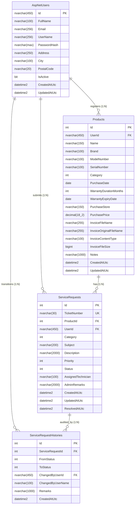

# PRODUCTCARE — Entity-Relationship (ER) Diagram
**Course:** INT402: Modern Web Programming Tools and Techniques  
**System:** ProductCare — Product Warranty and Service Management Portal

---

## 1. Entity-Relationship Diagram (Mermaid)

---

## 2. Cardinality and Referential Integrity Rules

1. **User to Product (1 : N):**
   - One `ApplicationUser` owns zero or more `Products`.
   - Each `Product` belongs to exactly one `ApplicationUser`.
   - Delete Behavior: `Cascade`. If a user profile is purged, their registered inventory is removed.
   - Unique Constraint: `(UserId, SerialNumber)` ensures a customer cannot register the same serial number multiple times.

2. **Product to ServiceRequest (1 : N):**
   - One `Product` has zero or more `ServiceRequests`.
   - Each `ServiceRequest` references exactly one `Product`.
   - Delete Behavior: `Restrict`. A product cannot be deleted if there is an active service ticket associated with it.

3. **User to ServiceRequest (1 : N):**
   - One `ApplicationUser` submits zero or more `ServiceRequests`.
   - Each `ServiceRequest` is owned by exactly one customer.
   - Delete Behavior: `Restrict`.

4. **ServiceRequest to ServiceRequestHistory (1 : N):**
   - One `ServiceRequest` has one or more `ServiceRequestHistory` audit entries.
   - Each history record represents an immutable state transition.
   - Delete Behavior: `Cascade`. Deleting a ticket purges its history logs.
